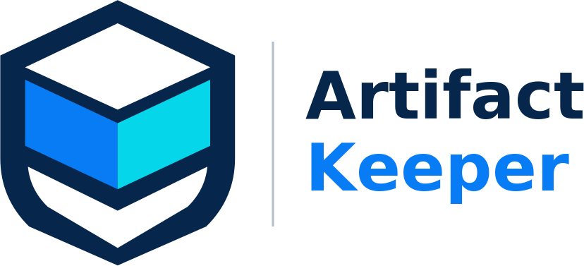

# Artifact Keeper brand assets

This directory holds the canonical Artifact Keeper logo files. The mark is the
**C1 "stacked artifact" shield**: a shield outline with a stacked box (an artifact)
inside it.

<p align="center">
  
</p>

## Palette

| Token | Hex | Used for |
|---|---|---|
| navy | `#06264B` | shield outline, "Artifact" text, dark tile |
| blue | `#087CF4` | left box face, "Keeper" text (light lockup), blue tile |
| cyan | `#06D6E9` | right box face, "Keeper" text (dark lockup) |
| white | `#FFFFFF` | box top, shield chevron, light tile |

## Which file to use

| Use | File |
|---|---|
| UI marks (navbars, login screens, docs headers), READMEs, any "mark on a background" | `symbol-primary.svg`, `symbol-primary-{16,24,32,48,64,96,128,256,512,1024}.png` |
| Monochrome contexts | `symbol-{navy,blue,cyan,black}.svg`, `-256.png`, `-512.png` |
| Avatars (GitHub org, Docker Hub, social accounts) | `symbol-primary-512.png` (transparent mark; `app-icon-blue-512.png` if a service needs a solid background) |
| iOS app icon (opaque, full-bleed, square corners) | `app-icon-1024.png` |
| macOS app icon (rounded, transparent corners) | `app-icon-1024-rounded.png` |
| Other app tiles | `app-icon-{blue,light,dark}.svg`, `-192.png`, `-512.png` |
| Browser tabs | `favicon.ico` (16 to 256), `favicon-32.png` |
| iOS home-screen bookmark | `apple-touch-icon.png` (180x180) |
| Horizontal lockup (shield + wordmark) | `logo-horizontal-light.png` (light backgrounds), `logo-horizontal-dark.png` (dark backgrounds) |

### Banners

All banners are the same artwork at different crops (RGB, no alpha).

| File | Size | Target |
|---|---|---|
| `banners/github-readme_1600x600.png` | 1600x600 | README headers and the org profile |
| `banners/github-social-preview_1280x640.png` | 1280x640 | GitHub repo social preview (Settings, Social preview) |
| `banners/website-open-graph_1200x630.png` | 1200x630 | Open Graph / Twitter card image |
| `banners/promotional-header_1500x500.png` | 1500x500 | promotional headers (X, LinkedIn, decks) |
| `banners/website-hero_1920x600.png` | 1920x600 | website hero |

## Linking

Raw URL pattern:

```
https://raw.githubusercontent.com/artifact-keeper/.github/main/brand/<file>
```

- READMEs may hotlink these URLs.
- Product UIs (website, web app, iOS, Android, Docker extension and so on) **vendor
  their own copies** and never hotlink raw.githubusercontent.com.

## Quirks

- `symbol-white.*` and `app-icon-dark.*` are plain silhouettes with the box detail
  removed. They are not drop-in "white logo" versions; use them only where a
  silhouette is wanted.
- `logo-horizontal-{light,dark}.svg` contain live `<text>` set in DejaVu Sans, so
  they render differently depending on installed fonts. Prefer the PNGs.
- The lockup PNGs here are already trimmed to 828x377 (the original pack PNGs were
  padded to 1400x1400).

## README header snippets

Option A, the banner:

```html
<p align="center">
  
</p>
```

Option B, the lockup (theme-aware):

```html
<p align="center">
  <picture>
    <source media="(prefers-color-scheme: dark)" srcset="https://raw.githubusercontent.com/artifact-keeper/.github/main/brand/logo-horizontal-dark.png">
    
  </picture>
</p>
```
